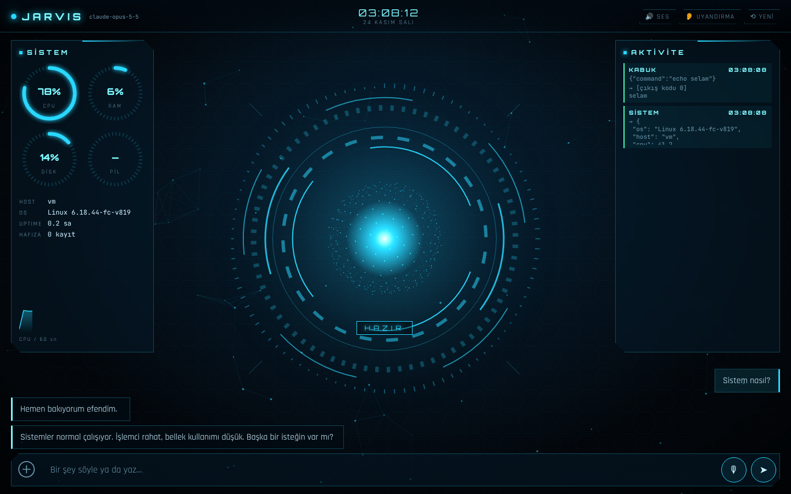
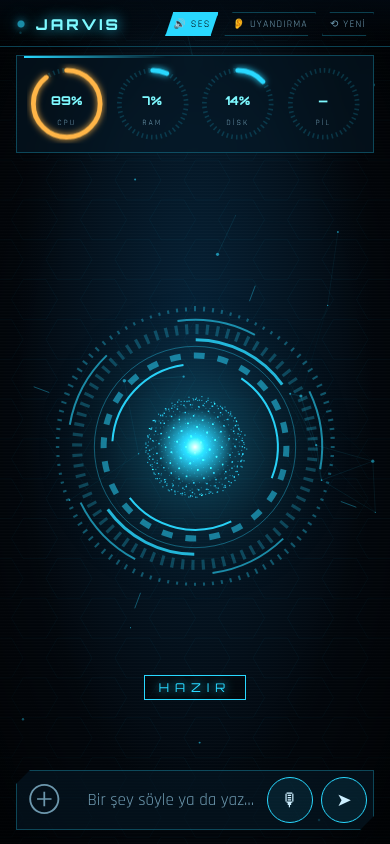

# JARVIS — Kişisel Yapay Zeka Asistanı

Bilgisayarını ve Android telefonunu sesle ya da yazıyla yöneten, animasyonlu HUD arayüzüne sahip kişisel bir yapay zeka ajanı. Beyni **Claude Opus 5.5**: adaptive thinking açık, araçları paralel kullanabiliyor.



## Neler yapabilir?

| Yetenek | Araç | Onay ister mi? |
|---|---|---|
| Terminal komutu çalıştırma (program kurma, dosya arama, git…) | `run_shell` | ✅ |
| Dosya okuma / klasör listeleme | `read_file`, `list_dir` | — |
| Dosya yazma | `write_file` | ✅ |
| Uygulama, site, dosya açma ("Spotify'ı aç") | `open_target` | — |
| **Ekranı görme** (ekran görüntüsü + görsel analiz) | `screenshot` | — |
| **Fare ve klavye kontrolü** (tıklama, yazma, kısayol) | `computer_control` | ✅ |
| CPU / RAM / disk / pil / işlemler | `system_status` | — |
| Pano okuma/yazma | `clipboard` | — |
| **Kalıcı hafıza** (seni tanır, tercihlerini hatırlar) | `remember`, `recall`, `forget` | silme ✅ |
| **Android telefon**: ekran, dokunma, kaydırma, yazma, uygulama açma, bildirimler, pil, arama, SMS | `phone` (ADB) | okuma dışındakiler ✅ |
| İnternette arama ve sayfa okuma (haber, hava, kur…) | `web_search`, `web_fetch` | — |
| Görsel anlama (fotoğraf yükle → yorumlasın) | arayüzdeki ⊕ | — |

"Riskli" işlemlerde ekrana bir onay penceresi gelir; sen izin vermeden çalışmaz. İstersen `JARVIS_AUTO_APPROVE=1` ile tamamen otonom yapabilirsin, ama bu ayar dikkat ister.

### Arayüz
- Açılış sekansı, 3B dönen parçacık küresi, segmentli ark reaktörü halkaları, sesle tepki veren dalga halkası
- Duruma göre renk ve hareket değişir: hazır (camgöbeği), dinliyor (yeşil), düşünüyor / çalışıyor (amber, hızlanan halkalar ve yörüngedeki kuyruklu yıldızlar)
- Canlı sistem göstergeleri, CPU grafiği, araç aktivite akışı, son ekran görüntüsü önizlemesi
- Modelin düşünce özeti reaktörün üstünde akar
- **Sesli konuşma:** 🎙 ile konuşursun (Türkçe), cevabı cümle cümle sesli okur
- **Uyandırma kelimesi:** 👂 UYANDIRMA açıkken "Jarvis, ..." demen yeter
- Telefonda tam ekran uygulama gibi çalışır (PWA, "Ana ekrana ekle")



## Kurulum

1. **Python 3.10+** kur.
2. Anthropic API anahtarı al: https://console.anthropic.com
3. Bu klasörde:
   - **Windows:** `start.bat` dosyasına çift tıkla
   - **macOS / Linux:** `./start.sh`

   İlk çalıştırmada `.env` dosyası oluşur. İçine `ANTHROPIC_API_KEY=...` yaz ve tekrar çalıştır.
4. Terminalde yazan `http://localhost:8765/?token=...` adresini **Chrome veya Edge** ile aç. Sesli giriş en iyi bu tarayıcılarda çalışır.

Manuel kurulum:
```bash
python -m venv .venv && source .venv/bin/activate   # Windows: .venv\Scripts\activate
pip install -r requirements.txt
cp .env.example .env     # anahtarını yaz
python server.py
```

> **macOS:** Ekran görüntüsü ve fare kontrolü için Sistem Ayarları → Gizlilik ve Güvenlik → *Ekran Kaydı* ve *Erişilebilirlik* altında Terminal'e izin ver.

## Telefondan kullanma

### 1) Telefondan JARVIS ile konuşmak
```bash
python server.py --lan
```
Terminal, telefonda açman gereken adresi yazar (`http://192.168.x.x:8765/?token=...`). Bilgisayar ve telefon aynı Wi-Fi ağında olmalı.

Telefon tarayıcıları **mikrofonu yalnızca HTTPS'te** açar. Sesli kullanım için iki seçenek var:
- **Tailscale (önerilen):** iki cihaza kur, `tailscale serve 8765` çalıştır. Hem HTTPS olur hem de evden uzaktayken çalışır.
- Kendi sertifikan: `python server.py --lan --cert cert.pem --key key.pem` (ör. `mkcert` ile üret).

### 2) JARVIS'in telefonunu kontrol etmesi (Android)
1. [Android Platform Tools](https://developer.android.com/tools/releases/platform-tools)'u kur (`adb`).
2. Telefonda: Ayarlar → Telefon hakkında → *Yapı numarası*na 7 kez dokun → Geliştirici seçenekleri → **USB hata ayıklama** (ya da **Kablosuz hata ayıklama**).
3. USB ile bağla veya kablosuz için `adb pair` / `adb connect IP:PORT` kullan, `adb devices` ile kontrol et.
4. Örnek istekler: "telefonumun şarjı kaç?", "telefonda WhatsApp'ı aç", "son bildirimlerimi oku", "telefon ekranına bak, ne açık?"

> iPhone'u Apple dışarıdan kontrol etmeye izin vermiyor. iPhone'dan JARVIS'e sadece web arayüzüyle bağlanabilirsin (1. yöntem).

## Ayarlar (`.env`)

| Değişken | Açıklama |
|---|---|
| `ANTHROPIC_API_KEY` | Zorunlu |
| `JARVIS_NAME` / `JARVIS_USER_NAME` | Asistanın adı / senin adın |
| `JARVIS_MODEL` | Varsayılan `claude-opus-5-5` |
| `JARVIS_EFFORT` | `low` … `max`. Yükseldikçe daha akıllı ama daha yavaş ve pahalı (varsayılan `high`) |
| `JARVIS_TOKEN` | Sabit erişim anahtarı. Boş bırakırsan her açılışta yenisi üretilir |
| `JARVIS_AUTO_APPROVE` | `1` = riskli işlemlerde onay sorma |
| `ELEVENLABS_API_KEY` | Doldurursan tarayıcı sesi yerine gerçekçi ElevenLabs sesi kullanılır |

Hafıza `~/.jarvis/memory.json` dosyasında tutulur.

## Kısayollar
- `Ctrl + Space`: mikrofonu aç/kapat
- `Esc`: durdur (konuşmayı ve işlemi keser)
- ⟲ YENİ: yeni konuşma (hafıza korunur)

## Mimari
```
tarayıcı (index.html + app.js)  ⇄ WebSocket ⇄  server.py (FastAPI)
   animasyon, ses, onay penceresi                 │
                                                   ├─ agent.py  → Claude API (akış, adaptive thinking,
                                                   │              web arama/okuma, refusal fallback)
                                                   └─ tools.py  → kabuk, dosya, ekran, fare, ADB, hafıza
```
Yeni bir araç eklemek için `tools.py` içinde bir `async` fonksiyon yaz ve `TOOLS` listesine bir `Tool(...)` satırı ekle.

## Güvenlik
- Sunucu varsayılan olarak yalnızca `127.0.0.1`'i dinler. `--lan` ile açtığında token olmadan erişilemez.
- Token'ı kimseyle paylaşma: o token'a sahip olan herkes bilgisayarında komut çalıştırmayı isteyebilir.
- Riskli araçlar onaysız çalışmaz (`JARVIS_AUTO_APPROVE=0`).
- `computer_control` sırasında fareyi ekranın sol üst köşesine götürürsen pyautogui acil durdurma yapar.
